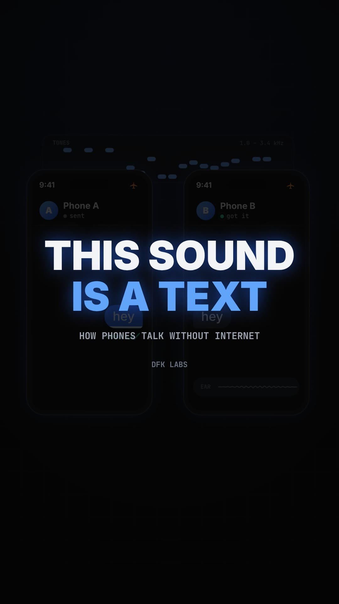
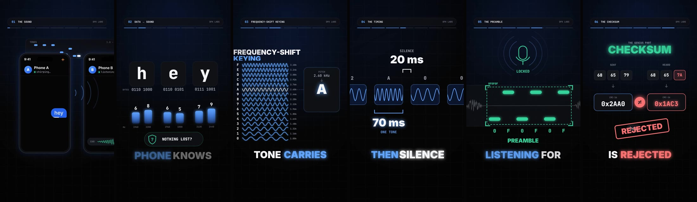
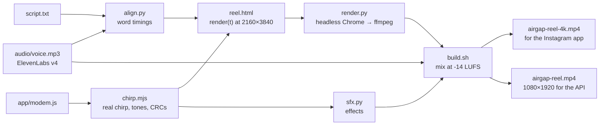

<p align="center">
  <a href="media/airgap-reel.mp4"></a>
</p>

<h1 align="center">airgap</h1>

<p align="center">
  <b>Text over sound.</b> Two phones, flight mode on. One chirps, the other reads the message.<br>
  No internet, no server, no account. One page, no dependencies.
</p>

<p align="center">
  <a href="https://dfklabs.com/labs/airgap"><b>Try it</b></a> ·
  <a href="media/airgap-reel.mp4"><b>Watch the 49 s explainer</b></a> ·
  <a href="#how-it-works">How it works</a> ·
  <a href="#the-explainer-reel">How the reel was made</a>
</p>

<p align="center">
  
  
  
  
</p>

---

## Try it

1. Open **[dfklabs.com/labs/airgap](https://dfklabs.com/labs/airgap)** on two phones.
2. Tap **Listen** on the one that receives.
3. Type on the other and tap **Chirp**. Flight mode can stay on.

The receiver chirps back when it has heard the message, so the sender knows it arrived.
There is Morse too.

## How it works

<p align="center"><a href="media/airgap-reel.mp4"></a></p>

airgap is a modem in about 330 lines of JavaScript (`app/modem.js`). It does arithmetic on
audio samples and nothing else, so the same file runs in the page and in Node.

**1 · Data becomes tones.** Every byte is split into two nibbles, and each nibble is one of
16 tones, 160 Hz apart, from 1.0 to 3.4 kHz: the band small phone speakers and microphones
reproduce best. One tone carries 4 bits.

| nibble | 0 | 1 | 2 | … | A | … | F |
|---|---|---|---|---|---|---|---|
| tone | 1000 Hz | 1160 Hz | 1320 Hz | … | 2600 Hz | … | 3400 Hz |

**2 · Timing.** A tone rings for **70 ms**, then **20 ms of silence** lets the room's echo die
down before the next one. A character takes two tones, about 0.18 s: slow on purpose, so it
works in a noisy room.

**3 · Packets.** A message travels as packets of up to 20 bytes, each one its own frame:

```
┌──────────────┬────────┬────┬──────┬──────────────────────┬──────────┐
│ preamble     │ length │ id │ part │ data (≤ 20 bytes)    │ CRC-16   │
│ 0 F 0 F 0 F  │ 1 byte │ 1  │ 1    │ UTF-8 of the message │ 2 bytes  │
└──────────────┴────────┴────┴──────┴──────────────────────┴──────────┘
```

- **The preamble** `0F0F0F` is a pattern the receiver is always listening for: it is how it
  knows a message is starting, and where each tone begins.
- **Short packets are why long messages arrive.** Each one locks on afresh, so clock drift or a
  moment of noise costs one packet, not the whole message, and a packet heard on the second
  try fills the gap. Up to 160 bytes (8 packets, about 40 seconds of sound).
- **The checksum** (CRC-16/CCITT) is computed over the whole packet. If one tone is misheard
  the numbers don't match, and the packet is dropped instead of shown wrong. In the reel:
  `hey` sent as `0x2AA0`; with one tone misheard (`y` → `z`) the receiver gets `0x1AC3`.

**4 · Listening.** The receiver measures the energy of each of the 16 frequencies with the
Goertzel algorithm, finds the preamble, and reads every tone from the middle of its slot.

Nothing leaves the page: no network requests, no audio stored, no personal data.

## The explainer reel

<p align="center">
  <a href="media/airgap-reel.mp4"><b>▶ media/airgap-reel.mp4</b></a> · 49 s · 9:16 · English voice-over with word-by-word captions
</p>

| | Chapter | What it shows |
|---|---|---|
| 0:00 | **The sound** | The real chirp of `hey` between two phones in flight mode. No Wi-Fi, no 5G, no server. |
| 0:06 | **Data → sound** | `h e y` → bits → nibbles → tones, with their frequencies. |
| 0:11 | **Frequency-shift keying** | The 16-tone ladder; pitch A = 2.60 kHz = `1010`. |
| 0:20 | **The timing** | 70 ms of tone, 20 ms of silence, the echo fading. |
| 0:27 | **The preamble** | `0F0F0F` rising out of the noise, and the receiver locking on. |
| 0:34 | **The checksum** | Real CRC-16 values; one misheard tone and the message is rejected. |
| 0:44 | **Old idea, new pocket** | From a 56k dial-up modem to a phone. |

Every frame is drawn by code: `reel/reel.html` paints the frame for any time *t* on a
2160×3840 canvas, and headless Chrome records it. Nothing was edited by hand.



- **Captions** come from forced alignment (`pocketsphinx`) of the known script against the
  recording, so each word lights up when it is said.
- **Camera:** handheld drift, slow push-ins, punches on key words, whip-pans with motion blur
  between chapters, a shake when the message is rejected.
- **Sound:** the voice plus the modem's own tones (the hook chirp, the 16-tone sweep, the
  preamble), whooshes on cuts, a blip on lock, a buzz on rejection.
- **Two outputs:** a 4K master to upload from the Instagram app, and a 1080×1920 copy for
  Instagram's API, which accepts at most 1920 px wide. Drawing at twice the size and scaling
  down keeps text and edges sharp after Instagram's own compression.

The script, the voice settings and the reasoning behind each choice are in
[`reel/script.md`](reel/script.md).

### Rebuild it

```bash
cd reel
pip install -r requirements.txt && python3 -m playwright install chromium
./build.sh          # → build/airgap-reel.mp4 and build/airgap-reel-4k.mp4
```

Needs Python 3.10+, Node 18+ and ffmpeg. To look at a few frames before a full render:
`python3 render.py stills 1.2 9.6 33.2`.

## Repository

```
app/      the page served at dfklabs.com/labs/airgap
  index.html     the whole interface, in one file
  modem.js       encoder, decoder, CRC: arithmetic on samples, no Web Audio inside
  sw.js          retired service worker that removes old offline copies
reel/     the explainer reel, drawn by code
  reel.html      render(t): every frame of the reel
  render.py      headless Chrome → one video file per chapter
  align.py       word timings for the captions
  chirp.mjs      the real chirp, tones and checksums, from app/modem.js
  sfx.py         sound effects on the timeline
  build.sh       the whole build, end to end
  script.md      voice-over, ElevenLabs settings, and why
  audio/         the voice-over (ElevenLabs, take 2)
  fonts/         Inter and JetBrains Mono (SIL Open Font License)
media/    the finished reel, its poster and storyboard
```

The live page is published from the DFK Labs site; `app/` mirrors it (v11, 2026-11-17).

## Credits

Made by **[DFK Labs](https://dfklabs.com)** · [@dfklabs](https://instagram.com/dfklabs).
Voice: [elevenlabs.io](https://elevenlabs.io). Fonts: Inter and JetBrains Mono, under the
SIL Open Font License (`reel/fonts/`).

Code under the [MIT License](LICENSE). The reel's video, poster and voice-over are © DFK Labs.
